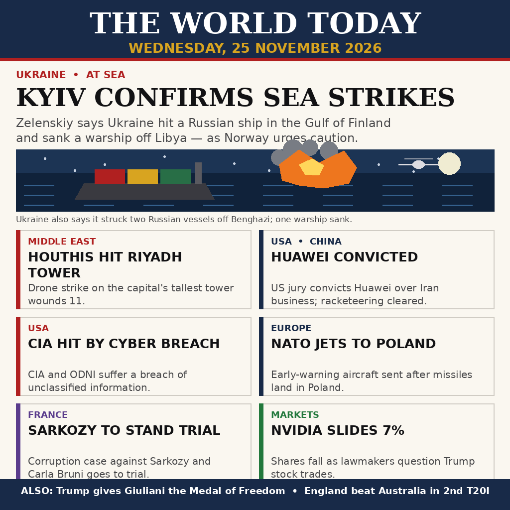

# news-image-20261125

An entry for the [make.fun bounty "Sum up 25 November's world news in one image"](https://make.fun/bounty/news-image-20261125).

The image is a newspaper front page for Wednesday, 25 November 2026. Its
lead story is Kyiv confirming sea strikes on Russian ships, with six more
stories from the day: the Houthi strike on Riyadh's tallest tower, Huawei's
US conviction, a cyber breach at the CIA and ODNI, NATO jets to Poland,
Sarkozy's corruption trial, and Nvidia sliding 7%.

`main.py` is the whole program: it checks that `entry.png` is a real PNG
and copies it unchanged to `$MAKEFUN_OUTPUT_DIR/entry.png`. No network,
no dependencies beyond the Python standard library. Run it twice and the
output bytes are identical.
